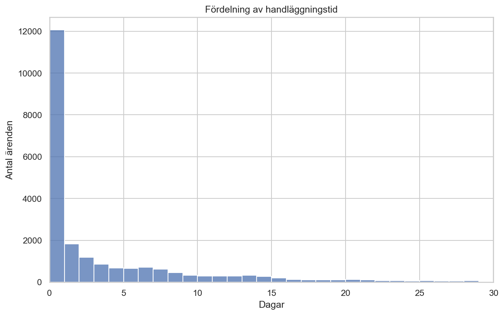
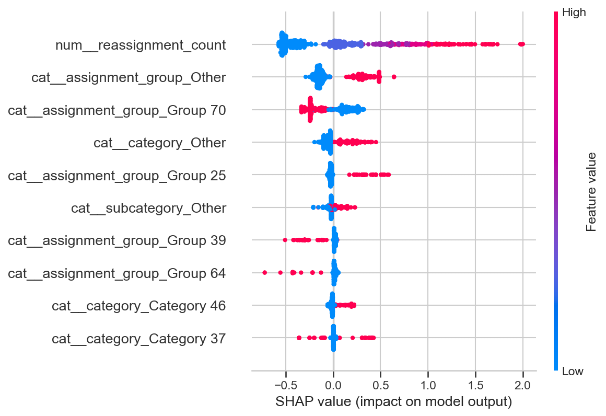
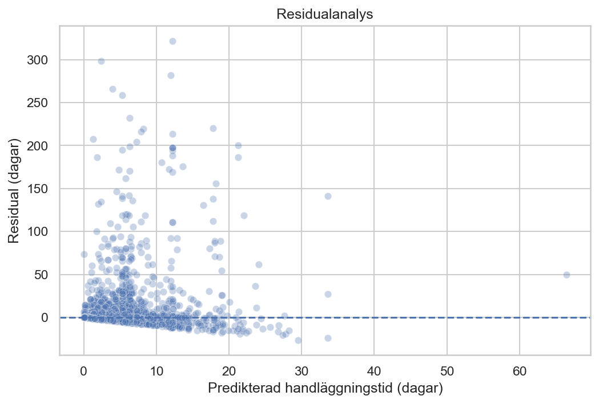

# Datadriven analys av handläggningstid i ärendehantering

## Projektöversikt

Handläggningstid är ett centralt mått på effektiviteten i en ärendehanteringsprocess. <br>
Det här projektet undersöker vilka processrelaterade faktorer som hänger ihop med handläggningstid och om handläggningstid kan predikteras utifrån ärendets egenskaper.

Projektet bygger på ett publikt incident management-dataset från ServiceNow (*IT Incident Log*, Kaggle). <br>
Resultaten visar vad som går att utläsa ur just det här datasetet, men metodiken och kodstrukturen är applicerbara på andra ärendehanteringsprocesser.

<br>

**Arbetsflöde:**
- Datainläsning och aggregering till ärendenivå
- Explorativ analys och nyckeltal (KPI)
- Hantering av *target leakage* och multikollinearitet
- Modelljämförelse med korsvalidering och utvärdering på testdata
- Log-transformering och hyperparameteroptimering
- Modelltolkning med SHAP och residualanalys
- Pipeline med automatiska tester

---

## Metod

### Data och förberedelse

Datasetet är en händelselogg med flera rader per ärende. Den aggregerades till 23 362 ärenden, efter att 1 556 ärenden utan lösningsdatum exkluderats. <br>
Handläggningstid beräknas som tiden mellan öppnat och löst ärende, i dagar.

Följande variabler används: antal omfördelningar, återöppnat ärende, prioritet, tilldelad grupp, kategori, underkategori och kontaktväg. <br>
Grupp, kategori och underkategori grupperas till de tio vanligaste värdena, och resterande samlas under "Other". Kategoriska variabler omvandlas med *one-hot encoding*.

Antal omfördelningar, antal återöppningar och tilldelad grupp avser värdena när ärendet avslutades. Analysen gäller därför historiska, avslutade ärenden och inte prediktion vid en bestämd tidpunkt.

**Target leakage och multikollinearitet**

- `sys_mod_count`, `high_activity_case` och `made_sla` exkluderas. De är konsekvenser av hur lång tid ärendet tar och inte kända vid prediktion. <br>
- `impact` och `urgency` exkluderas, eftersom de tillsammans entydigt bestämmer `priority`.

---

### Modellering

Fyra modeller jämförs:
- **Naiv baseline** (predikterar alltid medianen)
- **Linear Regression**
- **Random Forest**
- **Gradient Boosting**

Datan delas 80/20 i tränings- och testdata. <br>
Modellerna jämförs med femfaldig korsvalidering på träningsdatan, först utan och sedan med log-transformerad målvariabel, eftersom handläggningstiden är kraftigt högersnedfördelad. <br>
Felet mäts i dagar, efter att prediktionerna räknats tillbaka från log-skala. <br>
De trädbaserade modellerna hyperparameteroptimeras med **RandomizedSearchCV**. <br> Modellen med lägst korsvaliderat fel väljs utan att testdatan används. <br>
Den valda modellen utvärderas en enda gång på testdatan och tränas därefter om på all data.

**Utvärdering**

Prestandan mäts med **MAE** (i dagar) och **R²**. <br>
Residualanalys och **SHAP** används för att tolka den valda modellen.

---

## Resultat

Utan log-transformering presterade alla modeller sämre än den naiva baslinjen (korsvaliderat MAE 7,29 dagar mot 7,88–8,54). <br>
Efter log-transformering och hyperparameteroptimering hade Gradient Boosting (optimerad) lägst korsvaliderat fel och valdes:


| Modell                        | Korsvaliderat fel (MAE, dagar) |
|-------------------------------|--------------------------------|
| Gradient Boosting (optimerad) | 6,410                          |
| Random Forest (optimerad)     | 6,411                          |
| Gradient Boosting             | 6,463                          |
| Random Forest                 | 6,526                          |
| Naiv baseline (median)        | 7,295                          |
| Linear Regression             | 8,166                          |

<br>

Den valda modellen, Gradient Boosting (optimerad), fick MAE 6,54 dagar och R² 0,06 på testdata, vilket innebär att den förklarar bara en liten del av variationen. <br>
Random Forest (optimerad) låg tätt efter, och skillnaden mellan de två modellerna är mycket liten. <br>
Linear Regression ger orimliga prediktioner efter log-transformeringen, eftersom återtransformeringen kan ge extremt höga värden.

---

### Visualiseringar

**Fördelning av handläggningstid** är tydligt snedfördelad. Medianen är 0,92 dagar medan genomsnittet är 7,42 dagar, eftersom ett fåtal mycket långa ärenden drar upp medelvärdet.

<br>

<p align="center">

</p>

---

<br>

**SHAP-analysen** visar vilka variabler som påverkar modellens prediktioner mest. <br>
Antal omfördelningar (`reassignment_count`) har klart störst betydelse, följt av flera tilldelade grupper. <br>
Prioritet (`priority`) finns inte bland de tio viktigaste variablerna.
<br>

<p align="center">

</p>

---

<br>

**Residualanalysen** visar att modellen systematiskt underskattar handläggningstiden för de mest långdragna ärendena. De största avvikelserna är positiva, särskilt för ärenden med lägre predikterade värden.

<br>

<p align="center">

</p>

---

## Slutsatser & Lärdomar

Handläggningstid kan predikteras endast i begränsad utsträckning utifrån den tillgängliga datan. <br>
Det tyder på att datan saknar faktorer som sannolikt påverkar handläggningstiden, till exempel ärendets komplexitet och arbetsbelastning.

Projektet visar också vikten av att granska modellresultat kritiskt. En tidig modellversion gav betydligt lägre fel, men resultatet byggde på variabler med *target leakage*. <br>
När de togs bort presterade modellerna initialt sämre än baslinjen.

---

## Framtida utveckling

- Testa fler modeller och en bredare hyperparameteroptimering
- Klassificera om ett ärende riskerar att bli långdraget i stället för att prediktera antal dagar
- Tidsbaserad uppdelning av datan för att se hur modellen fungerar på nyare ärenden
- Automatisk omträning när ny data tillkommer
- Dashboard som följer nyckeltal och visar prediktioner

---

## Projektstruktur

```text
incident-handling-time/
│
├── images/
│
├── notebooks/
│   └── incident_analysis.ipynb
│
├── src/
│   ├── data_prep.py
│   ├── log_config.py
│   ├── model.py
│   └── pipeline.py
│
├── tests/
│   ├── test_data_prep.py
│   └── test_model.py
│
├── .gitignore
├── README.md
├── pytest.ini
└── requirements.txt
```

Repot innehåller notebook för analys, modulär pipeline i `src/`, automatiska tester i `tests/`, samt figurer för visualiseringar i README. <br>
Mapparna `data_input/` och `data_output/` skapas lokalt och ingår inte i repot.

---

## Installation och körning

**Data**

Datasetet *IT Incident Log* av Shamiul Islam Shifat hämtas från [Kaggle](https://www.kaggle.com/datasets/shamiulislamshifat/it-incident-log-dataset). <br>
Lägg filen `incident_event_log.csv` i mappen `data_input/`.

**Installation**

Kopiera repot och installera beroenden (testat med Python 3.11):

```bash
git clone https://github.com/lencemajzovska/incident-handling-time.git
cd incident-handling-time
pip install -r requirements.txt
```

Kör hela flödet:

```bash
python src/pipeline.py
```

Flödet:
1. Läser in och aggregerar data till ärendenivå
2. Delar upp datan 80/20
3. Korsvaliderar modellerna på träningsdatan, med log-transformerad målvariabel och fel mätt i dagar
4. Hyperparameteroptimerar Random Forest och Gradient Boosting
5. Väljer modellen med lägst korsvaliderat fel
6. Utvärderar den valda modellen på testdatan, en enda gång
7. Tränar om modellen på all data och sparar den

---

## Kodstruktur, loggning & test

Projektet är uppdelat i funktionella moduler:
- **data_prep.py** - inläsning, rensning och aggregering av händelseloggen till ett ärende per rad
- **model.py** - gruppering av kategorier, *one-hot encoding*, log-transformering, modeller, korsvalidering, modellval, hyperparameteroptimering och utvärdering
- **log_config.py** - loggkonfiguration
- **pipeline.py** - kör hela flödet och sparar slutmodellen i `data_output/`

### Loggning

Förloppet skrivs både till terminalen och till en loggfil i `logs/`, som skapas vid körning. <br>
Varje körning får en egen fil, till exempel `pipeline_2026-10-14_20-33.log`.

<br>

```text
2026-10-14 20:33:05 | INFO | __main__ | Läser och aggregerar data från ...\data_input\incident_event_log.csv
2026-10-14 20:33:06 | INFO | __main__ | Antal ärenden: 23362
2026-10-14 20:33:06 | INFO | __main__ | Uppdelning 80/20: 18689 träningsärenden, 4673 testärenden
2026-10-14 20:33:06 | INFO | __main__ | Korsvaliderar modellerna på träningsdatan
2026-10-14 20:33:21 | INFO | __main__ | Hyperparameteroptimering: Random Forest (RandomizedSearchCV)
2026-10-14 20:33:59 | INFO | __main__ | Hyperparameteroptimering: Gradient Boosting (RandomizedSearchCV)
2026-10-14 20:34:41 | INFO | __main__ | Vald modell: Gradient Boosting (optimerad)
2026-10-14 20:34:41 | INFO | __main__ | Testdata, Gradient Boosting (optimerad): MAE = 6.54 dagar, R² = 0.06
2026-10-14 20:34:45 | INFO | __main__ | Slutmodellen är tränad på 23362 ärenden och sparad i ...\data_output\best_model.joblib
```

### Testning

Testerna i `tests/` kontrollerar att:
- variabler med *target leakage* inte används
- grupperingen till de tio vanligaste kategorierna lärs in på träningsdatan
- okända kategorier hanteras utan fel
- prediktionerna anges i dagar
- korsvaliderat fel mäts i dagar
- modellen med lägst korsvaliderat fel väljs
- resultaten går att återskapa

Testerna som kontrollerar resultaten mot datasetet körs bara om `data_input/incident_event_log.csv` finns. <br>
Övriga tester körs alltid.

Kör testerna med:

```bash
python -m pytest
```